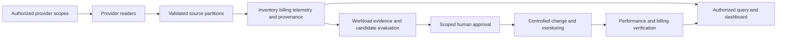

# GreenCloud AI product requirements and implementation gates

GreenCloud connects financial, infrastructure, workload and environmental evidence across authorized AWS accounts, Azure subscriptions and GCP projects. The product progresses from monitoring to investigation and recommendations, then to approved changes with verified outcomes. A successful recommendation reduces avoidable cost or emissions while preserving the organization’s operational constraints.

The [dashboard architecture](../dashboard-architecture.md) defines the hierarchy, role/widget matrix, dashboard surfaces and provider mapping. The [glossary](../glossary.md) defines domain terms. The [research register](./RESEARCH_EVIDENCE.md) links provider semantics, evidence and experiments. The earlier [AWS-first blueprint](./PROJECT_BLUEPRINT.md) supplies a bounded pilot and its evaluation plan. The pilot remains the first live integration milestone within a shared multi-cloud architecture.

## System requirements

| Requirement | Observable acceptance |
| --- | --- |
| Shared organization model with scoped access | One organization can associate distinct AWS accounts, Azure subscriptions and GCP projects with multiple workspaces. A user can access only the authorized subset for each operation. Restricted resources never affect visible counts, aggregates, exports, recommendation search or job progress. |
| Source-preserving ingestion | An operator can trace any value back to provider, billing or resource scope, source, timestamps, resolution and transform version. Jobs retry transient failures, retain good data on partial failure and avoid duplicate rows. Import, fixture and live observations have separate labels. |
| Useful monitoring | The dashboard shows account and source freshness, inventory state, measured usage, and supported signals. Unconfigured memory, stale metrics, absent authority, and actual zero are distinguishable. A resource inspection view traces metrics and costs to their source and grain. |
| Financial intelligence | Cost trends, budgets, anomalies, estimates, commitments and allocation use compatible units, currencies, periods and scopes. Resource costs preserve unattributed charges. Adjustments and late corrections reconcile to the provider. |
| Workload intelligence | Investigations show representative history, resolution, p50/p90/p95/p99 where valid, saturation, seasonality, application SLIs and relevant dependencies. A low CPU measurement is a signal for investigation. |
| Constrained optimization | Candidates must satisfy compatibility, regional availability and explicit safety requirements before ranking. Distinguish vertical sizing, horizontal capacity and architectural change. Compare current and candidate configuration, evidence, price basis, savings ranges, risk and dependencies. |
| Authorized changes and verification | Every approved plan includes operator, exact scope, baseline, success thresholds, monitoring window and rollback plan. Execution state is independently audited. Verified savings require comparable settled costs and a defensible counterfactual. |
| Transparent GreenOps | Publish modeled emissions or provider emissions with methodology and boundary. Track operational and embodied emissions separately. Compute SCI only with a comparable functional unit and documented energy/grid inputs. |

## Domain contracts and flow

Use the organization and workspace scope as the authorization boundary. Preserve provider account identity independently of workspace selection. Treat workloads as relationships across resources, not as provider-specific inventory children. Keep resource lifecycle, provider health and application SLO state as distinct signals.

| Proposed model | Identity and data |
| --- | --- |
| Organization, Workspace, WorkspaceMembership, ScopeGrant | Organization and workspace IDs, authenticated subject, effect, permission, scope and provenance. Account and resource grants are explicit. |
| ProviderConnection, CloudScope | Provider, partition or tenant, canonical provider ID, source type, credential reference, discovery authority, parent payer or billing identity, capabilities and allowed workspace mappings. |
| Resource, Workload, WorkloadResource, Dependency | Canonical resource key, service, region, lifecycle, owner, labels, workload relationships, observed dependency source and timestamp. |
| Observation and BillingFact | Durable source key with account, time and resource where known. Preserve metric/unit/resolution, or currency/cost metric/charge grain. Keep raw source references, quality status and observed versus estimated flags. |
| SyncJob and SourceState | Attempt, lease, account and source, cursor, last success, completeness, error classification and retry schedule. Store findings by source to preserve useful partial results. |
| Candidate, Decision, Execution and Verification | Immutable baseline and candidate evidence, price version, policy decision, approved actor and scope, guarded execution events, rollback status and comparable post-change evidence. |

For the first API slice, resolve the user and workspace server-side. GET /api/dashboard uses authorized filters before issuing database reads and returns source coverage with each aggregate. Account, resource, export and job endpoints share the scope resolver. Mutations require permission and workspace checks. The existing presentation role selector may choose widgets inside the permission envelope. It never supplies identity or authorization.

## Calculation contracts

| Measure | Proposed calculation and limits |
| --- | --- |
| Spend | Sum signed charges in one currency, one charge grain and one billing metric over a half-open period. De-duplicate payer/member and export/API overlap. Separate billed, effective and price-model estimates. |
| Budget | Utilization = 100 × actual ÷ budget. Variance = actual − budget. Budget must be positive and match account scope, currency and period. Forecast variance uses the month-end forecast and is labeled forecast. |
| Telemetry | For equally spaced, valid samples compute mean as sum divided by valid count. For uneven intervals use duration weighting where appropriate. Percentiles use a documented estimator and the observed sampling grain. Report expected interval count, coverage, peak duration plus frequency and exclude gaps from measured zero. |
| Headroom | Compute allowed capacity minus representative demand in equivalent units. For a single instance, normalized CPU demand can use vCPU capacity × utilization if architecture and benchmark assumptions are defensible. Check memory in bytes, throughput and IOPS separately. Compare repeated peaks and application objectives. |
| Forecast | Compare existing Holt, seasonal naïve and moving average across rolling-origin validation. MAE is mean absolute error in original units. Report empirical interval coverage as observed outcomes inside the interval divided by forecast points, with interval width and horizon. Report insufficient history. |
| Candidate selection | Filter hard constraints on architecture, workload compatibility, capacity, SLO, region, availability and security first. Rank the feasible set on modeled cost and optional risk, performance and emissions. Show the reasons a rejected alternative failed or a check was inconclusive. |
| Savings | Estimated saving is projected baseline cost minus projected candidate cost under shared demand assumptions. Verified saving is comparable counterfactual billed cost minus post-change settled billed cost. Use rates × demand only when costs scale with demand; otherwise match cohorts or use a control. Explicitly account for fixed, shared and committed charges. |
| Carbon | Model operational emissions as Σ kWh × applicable regional gCO₂e/kWh. Disclose grid basis and energy assumptions. Add supported embodied allocation. SCI = (operational + embodied emissions) ÷ validated functional units in the same system boundary and period. |

Example review gate. A workload has CPU p95 at 35% and memory p95 at 91%. A smaller candidate that cannot meet the configured memory limit is rejected before estimating its savings. If essential memory observations are missing, the system can surface an investigation and requests the signal before offering a resize. For post-change latency at 195 ms against a 200 ms p95 limit, classify the observed SLO separately from monitoring risk and savings verification. A small headroom or weak sample can trigger extended monitoring even when the current observation is in bounds.

## Implementation sequence and acceptance gates

The rows are incremental gates. Phase ordering reflects dependencies. Existing code and experiments provide test assets and need to meet each gate before release.

| Phase | Build and dependencies | Validate before moving on |
| --- | --- | --- |
| 1. Domain and product | Glossary, product requirements, signal ownership, scoped workflows and measurable outcomes. | Walk through a multi-provider workload, missing telemetry, viewer, admin, failed sync and verification scenarios. |
| 2. Research | Compare primary studies and provider standards. Map each result to an explicit experiment, assumption or design choice. | Trace cited results and baselines. Record gaps before choosing forecasting, rightsizing or carbon-control models. |
| 3. Architecture | Organization/workspace boundary, resource identity, source facts, authenticated actor and granular grants. Map existing Tenant and RoleAssignment tables to a scoped model with an upgrade path. | Test the model with two organizations, overlapping provider IDs, workspace subsets, per-account grants and denied aggregates. Define authenticated API contracts before shared access. |
| 4. Provider foundation | Build read-only connector contract and validate AWS first. Extend to Azure subscription discovery and GCP project discovery with their own identities and capabilities. | Verify each provider in its own sandbox and multi-account fixture. Fail clearly on missing permission, invalid scope and unsupported service. |
| 5. Ingestion | Add durable jobs, source timestamps, billing and metric facts, data-quality reports, cursor handling, rate limits and partition retries. | Retry a partial batch without duplicates or data loss. Reconcile two account scopes by date, currency and metric. Force one account failure while other accounts progress. |
| 6. Monitoring | Inventory and resource inspection backed by normalized resource states and historical observations. | Check p50 through p99 against reference samples, empty and stale telemetry, unknown health, and retiring absent resources only after successful coverage. |
| 7. Dashboard | Use shared scope, freshness, coverage and drill-down components. Apply six role presentations and backend permissions. Roll out charts when their source exists. | Test every widget with representative data, missing signals, mixed currencies, scoped navigation and unauthorized accounts. |
| 8. Cost intelligence | Add allocation, budgeting, anomaly attribution, trend and forecast, then commitment and unit economics. | Compare with source bills and seeded anomalies. Forecast beats a baseline at its intended horizon or retain the baseline. |
| 9. Resource intelligence | Define service-specific signals and evidence gates for idle, low utilization, contention and poor coverage. | Use replay cases with low CPU but high memory, burst patterns, savings overlap, and stale observations. Measure false positives and abstentions. |
| 10. Recommendations | Discover compatible candidates, enumerate region-specific prices, enforce limits, document evidence and risk. | Stress-test compatible and incompatible cases and compare with provider-native baselines. Suppress action where critical evidence is unavailable. |
| 11. Lifecycle | Approved plans, separate execution identity, controlled rollout, monitoring, abort, rollback and outcome inspection. | Use a reversible sandbox action with a fault injection, signed or immutable evidence, SLO breach and rollback test. Wait for settled facts to verify savings. |
| 12. GreenOps | Versioned energy and factor models, validated functional unit, workload and regional context, eligible alternatives. | Independently calculate estimated emissions, assess uncertainty and test scheduling candidates against deadline and locality. |
| 13. Validation | Provider contract, backfill, load, segregation, permissions, migration, reliability and usability tests run throughout phases. | Validate representative live scopes and documented fixtures. Run failure isolation and large inventory benchmarks against agreed budgets. |
| 14. Production | Deploy with managed database, retention, backup, restore, rate limits, observability and incident playbooks. | Complete backup restore, operational drills, performance and access checks before enabling shared deployments. |

## Technical decisions and open questions

| Decision | Rationale and status |
| --- | --- |
| Shared contracts with an AWS-first live pilot | Stabilizes a proven provider path while preserving room for Azure and Google Cloud. Azure and GCP live integration remains a release gate for multi-cloud. |
| Permissions precede organization-wide rollout | The current workspace selector and simplified role checks do not establish authenticated membership. Implement scoped grants before presenting the dashboard as enterprise-ready. |
| Evidence precedes ranking | Start with deterministic filters and explicit price calculations. Introduce learned ranking or forecasting only if it improves the target evaluation without increasing unsafe decisions. |
| Outcome has two axes | Track operational criteria and actual attributable savings separately. An SLO-compliant change can still have unverified billing or low headroom. |
| Comparison requires compatible scope | Store observed date, effective period, currency, metric, resolution, version and method. Compare like-for-like or disclose limits. |

- [x] Refresh the glossary, requirements and representative literature comparison.
- [x] Record architecture, KPI definitions, presentation matrix and provider mapping.
- [ ] Review the architecture with concrete organization membership, provider authority and migration examples.
- [ ] Specify the authenticated actor and scoped authorization contracts with a fixture spanning accounts and organizations.
- [ ] Validate native Azure and Google Cloud permissions, source lag and quotas in authorized sandboxes.
- [ ] Establish labeled workload traces and a price/telemetry source for a reproducible candidate evaluation.
- [ ] Decide acceptable coverage, SLO margins, cost comparison tolerance and retention per pilot workload.

Open questions include the initial identity provider, which workspace memberships apply to a shared provider connection, how organizations declare workload ownership and SLOs, and what live accounts and export data are available for a reproducible pilot. Thresholds, prices, provider cadence and outcomes remain explicit inputs to verification.
