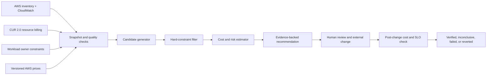

# GreenCloud AI — research-grade prototype blueprint

**Prepared:** 26 November 2026  
**Status:** Design proposal based on a code audit and source review; no new implementation is claimed.  
**Primary question:** Can a transparent, constraint-aware workflow identify AWS cost reductions and verify realized savings without harming a workload's stated operating requirements?

## 1. What we are building

GreenCloud AI is a decision-support system for cloud cost optimization. It connects inventory, telemetry, billing, and workload constraints; generates candidates; rejects unsafe candidates; explains surviving recommendations; records a human decision; and checks the outcome after a real change. Carbon is a secondary, separately qualified estimate. “AI” should mean a measured model that improves a defined task over a baseline, not a label on deterministic rules.

The first research release is **one AWS account, one or two workload groups, read-only collection, no automatic cloud mutation**. It should cover EC2 rightsizing and idle-resource investigation for EC2, EBS, and public IPv4. It must be useful with a reproducible fixture dataset even when live AWS access is unavailable. A reviewer may record an externally performed change, after which the system measures cost and guardrails. Azure, GCP, commitment buying, direct execution, and multi-tenant SaaS are later work.

### Objectives and non-goals

| Objective for first release | Explicit boundary |
| --- | --- |
| Explain each candidate using exact inputs and calculation version | Do not present a threshold as proof that a workload is idle |
| Show billed spend, modeled price, and estimated savings separately | Do not attribute a whole service bill to one EC2 instance |
| Block a recommendation when required telemetry or constraints are missing | Do not invent memory, latency, or ownership data |
| Verify outcomes against a stated baseline and guardrails | Do not mark a ticket or file as an executed infrastructure change |
| Publish a repeatable evaluation with baselines and failures | Do not claim production savings from synthetic fixtures |

## 2. Existing repository: observed state

The current app uses Next.js 14, Prisma/SQLite, AWS SDK, an onboarding UI, a dashboard, and API routes. It does perform AWS STS role assumption, inventory collection, CPU telemetry retrieval, and service-level Cost Explorer queries. Its report and UI describe a more complete system than the code demonstrates. The table below is a **code audit**, not a judgment about the intended design.

| Area | What code currently does | Implication for a scratch build |
| --- | --- | --- |
| Identity | API routes seed and use the same default tenant; no request authentication is visible. | Start with a local single-user prototype; do not claim tenant isolation. Add identity before any shared deployment. |
| Credentials | Role ARN/external ID is supported, but encrypted static access keys are also stored. `encryption.ts` has a hard-coded fallback secret. | Use cross-account read-only roles and external IDs; fail closed if a required secret is absent. Avoid stored long-lived AWS keys. |
| Billing | `ingestion.ts` fetches 30 days of service-level `UnblendedCost`, deletes prior rows, copies that value into both billed and effective cost, and assigns each service row to the first matching resource. | Preserve billing grain and lineage. Use resource-level CUR 2.0 when enabled; keep unallocated charges unallocated. Do not call this FOCUS normalization. |
| Pricing | `awsConnector.ts` contains a small US-East-1 price table, a fallback price for unknown instance types, and a 730-hour month. | Price candidates with explicit region, term, operating system, tenancy, purchase option, and timestamp. If price is absent, withhold savings. |
| Telemetry | EC2 CPU is collected; memory and application SLOs are not generally available. Missing CPU can become zero in the carbon estimate. | Model missingness explicitly and require coverage. Collect memory only when the agent is installed; make application guardrails optional but required for high-risk action. |
| Recommendations | Low average CPU can produce a stop suggestion; rightsizing is a fixed 40% saving without a target instance. Risk/confidence are constants; regeneration may reactivate a decided item. | Require a specific feasible target, service ownership, evidence window, and versioned state transition. Calibrate confidence from data or omit it. |
| Public IPv4 | Idle address pricing uses an additional idle charge. | AWS currently lists $0.005/hour for both in-use and idle public IPv4; compute avoidable cost from the actual bill and action. |
| Carbon | Static regional factors and simplified vCPU power estimates; dashboard inserts a fixed functional-unit denominator and derived history. | Call these modeled estimates. Do not claim measured SCI or verified emissions. Track provider carbon data separately at its published monthly grain. |
| Workflow | Approval generates local Markdown or a sample Terraform diff, then sets status to `executed`; there is no AWS mutation or post-change check. | Separate `approved`, `change_recorded`, `monitoring`, `verified`, and `reverted` states. Keep generated files as artifacts only. |
| Sync/test | Sync may be marked active if only one of four scans succeeds. End-to-end script seeds synthetic SQLite records; it is not a live AWS test. | Record per-source coverage and fail recommendation gates independently. Use fixtures for repeatability and a separate optional live integration test. |

Files supporting this audit include `src/services/awsConnector.ts`, `ingestion.ts`, `recommendationEngine.ts`, `carbonEngine.ts`, `encryption.ts`, `ticketService.ts`, `src/app/api/recommendations/[id]/approve/route.ts`, `src/app/api/dashboard/route.ts`, and `prisma/schema.prisma`. The audit did not edit them. The pre-existing working tree contains changes, so a new repository or a new isolated directory should be used for implementation.

## 3. Research synthesis and gap

Existing AWS tools already supply recommendations and estimated savings. [Compute Optimizer](https://docs.aws.amazon.com/compute-optimizer/latest/ug/view-ec2-recommendations.html) examines resource specifications and recent utilization; [Cost Optimization Hub](https://docs.aws.amazon.com/cost-management/latest/userguide/coh-savings-opportunities.html) consolidates overlapping opportunities. GreenCloud should benchmark against them rather than claim to have invented rightsizing. The defensible research gap is a **reproducible, workload-specific decision and verification layer**: document the input coverage, enforce declared performance/reliability constraints, distinguish billed and modeled economics, then measure what happened after a human made a change. This is a proposed contribution until experiments demonstrate it.

The literature supports constraint-aware optimization and carbon-aware scheduling, but published results generally involve their own workloads, pricing models, or flexible jobs. They do not justify copying headline savings percentages into GreenCloud. See [research evidence](./RESEARCH_EVIDENCE.md) for scope and access limits.

## 4. System design

Use a modular monolith for the prototype: a collection job, typed domain services, a relational database, an API, and a small review UI. Separate modules at the data contracts, not as microservices. Pin SDK and schema versions. SQLite is acceptable for an offline prototype; PostgreSQL becomes useful when concurrent ingestion, multi-user access, or larger billing exports are needed. Run fixtures locally. Live AWS should use a dedicated least-privilege cross-account role with external ID and read-only policy. Write-capable permissions are outside the first release.

### Minimum durable records

| Record | Key fields and purpose |
| --- | --- |
| `CollectionRun` | account, started/finished, source, interval, cursor, status, error, completeness; prevents a partial scan being shown as complete. |
| `ResourceSnapshot` | provider ID, account, region, type, attributes, tags, observed time, source; retain changes over time. |
| `MetricSeries` | resource/workload ID, metric name, unit, period, timestamp, value, coverage, source; missing values stay missing. |
| `BillingLine` | source row ID, account, period, currency, charge type, resource ID if provided, billed/effective cost when defined, export version; preserve raw provenance. |
| `PriceQuote` | SKU/attributes, region, purchase option, unit, amount, effective date, source; no silent generic fallback. |
| `WorkloadPolicy` | owner, resource group, criticality, permitted change windows, CPU/memory/network headroom, SLO, exclusions, version. |
| `Candidate` | current configuration, target/action, evidence window, hard-gate results, estimated cost range, risk notes, method version. |
| `Decision`/`ChangeEvent` | reviewer, decision, external change ID, actual change time, prior state; audit trail. |
| `Outcome` | baseline and follow-up windows, observed cost delta, guardrail deltas, confounders, status, reviewer. |

Store source data with the source's actual granularity. A service-level Cost Explorer total must not become a resource bill by matching service name. AWS [CUR 2.0 with resource IDs](https://docs.aws.amazon.com/cur/latest/userguide/table-dictionary-cur2.html) is a better input for resource economics, although some shared charges still require an allocation policy. AWS's FOCUS export and the current FOCUS standard are distinct versions: [FOCUS 1.4 is the published latest specification](https://focus.finops.org/what-is-focus/), while [AWS documents a FOCUS 1.2 export](https://docs.aws.amazon.com/cur/latest/userguide/table-dictionary-focus-1-2-aws.html). Record the export version and map only columns whose semantics are understood.

### Prototype API contract

The UI should consume the same typed service functions used by fixture tests. A small REST surface is enough; the path names below are proposals, not existing routes.

| Route | Contract and invariant |
| --- | --- |
| `POST /api/collection-runs` | Start a read-only import for a defined account and period; return run ID and source statuses. Never report whole-run success when required sources failed. |
| `GET /api/collection-runs/:id` | Return freshness, coverage, missing fields, and source errors. |
| `PUT /api/workload-policies/:id` | Save a versioned owner-approved policy with SLO, exclusions, and allowable target types. |
| `POST /api/candidates/evaluate` | Return candidate targets and per-gate pass/fail/unknown evidence for a policy and snapshot version. Idempotent for the same inputs. |
| `POST /api/candidates/:id/decisions` | Record reviewer decision and comment; require a valid state transition. |
| `POST /api/changes` | Record an external change ID and actual change time; never perform the cloud mutation. |
| `GET /api/changes/:id/outcome` | Return pending or measured outcome with baseline, follow-up, freshness, confounders, and guardrail results. |

Every response should carry a stable ID, method version, UTC timestamp, source IDs, and an error envelope that distinguishes missing evidence from connector failure. Mutating routes require local-user authentication before any network-exposed deployment; the first lab can run locally with a single user. Do not accept `tenantId` or `approver` supplied only by a browser as proof of identity.

## 5. Recommendation method

### Inputs and gates

1. Identify a workload group and owner. Unknown owner means **investigate only**.
2. Require a representative 14-day utilization window, with an explicit coverage threshold chosen before evaluation. Check peaks and daily/weekly pattern, not just the mean. AWS Compute Optimizer also uses a 14-day default window and requires minimum data; [memory requires CloudWatch Agent or supported external metrics](https://docs.aws.amazon.com/compute-optimizer/latest/ug/ec2-metrics-analyzed.html).
3. Read workload policy: SLO, resilience class, autoscaling membership, platform/architecture, operating system, required storage/network capabilities, reserved or Savings Plans coverage, and maintenance window.
4. Generate only technically compatible targets. For EC2, enumerate valid instance types and reject candidates that fail resource limits or policy. For EBS and public IPv4, inspect attachment, ownership, retention, and network dependency before any delete/release suggestion.
5. Estimate cost using the correct region/term. Record a range if future usage is uncertain. Reject a candidate when its price is unknown or if effective savings are not positive after commitment effects.
6. Rank feasible candidates by modeled monthly cost reduction, then estimated carbon change and risk. Never override a failed hard constraint with a score.

Formally, for workload \(w\) and candidate configuration \(x\):

\[
\min_x\; \widehat{C}(x,w) \quad \text{subject to}\quad
P_{95}(x,w)\leq P_{max},\; A(x)\geq A_{min},\; x\in X_{compatible},\; D_{coverage}\geq D_{min}.
\]

Here \(\widehat{C}\) is a price-and-usage estimate, \(P_{95}\) a chosen performance indicator, and \(A\) the required availability property. A metric can be constrained only if it is measured or a valid conservative bound is available. The first optimizer can simply filter and enumerate candidates. Graph search or ML is justified later if workload placement or forecast complexity makes it better than that baseline.

### Savings and overlap

Show three different numbers: **current billed cost** for the observation window; **modeled cost difference** between current and target configurations under stated assumptions; **verified realized change** after a real action. Avoid adding savings for mutually exclusive recommendations on the same resource. AWS [Cost Optimization Hub](https://docs.aws.amazon.com/cost-management/latest/userguide/coh-savings-opportunities.html) explicitly adjusts for overlap; GreenCloud should implement and test its own overlap logic before displaying a portfolio total. Compute public IPv4 avoided cost from the bill and action, not a double idle rate; the [AWS VPC pricing page](https://aws.amazon.com/vpc/pricing/) lists $0.005/hour for both in-use and idle public IPv4.

### Carbon accounting

Keep three views separate: provider-reported account/region emissions; a transparent operational energy/grid-intensity model; and the modeled change between candidates. Each needs an uncertainty note and time/region granularity. The [Green Software Foundation SCI](https://greensoftware.foundation/standards/sci/) is \((E\times I+M)/R\), where \(R\) is a meaningful application functional unit. Do not publish an SCI number until \(R\), energy, intensity, and embodied emissions are defensible. [AWS carbon exports are monthly](https://docs.aws.amazon.com/cur/latest/userguide/table-dictionary-carbon-emissions.html) and [can be revised when methodology changes](https://docs.aws.amazon.com/ccft/latest/releasenotes/what-is-ccftrn.html); they are not a per-instance real-time meter.

## 6. Verification protocol

The human reviewer performs any infrastructure change outside GreenCloud and records its ID, effective timestamp, expected effect, and rollback plan. GreenCloud waits for billing data freshness; [Cost Explorer is refreshed at least daily and current-period charges can lag](https://docs.aws.amazon.com/cost-management/latest/userguide/ce-enable.html). It then compares matched pre/post windows of equal length and similar weekday mix. Normalize by workload volume where possible (for example, cost per 1,000 jobs), and report traffic, seasonality, price/commitment, deployment, and SLO changes as confounders. A simple before/after delta is descriptive, not automatically causal. For stronger evidence, use a control workload or difference-in-differences when feasible.

Outcome states: `pending_data`, `verified_saving`, `no_saving`, `guardrail_failed`, `inconclusive`, `reverted`. Report the observed delta with a defined window and uncertainty; never write “saved $X” from a pre-change estimate. A failed performance guardrail blocks a successful outcome even if cost dropped.

## 7. Research evaluation

| Experiment | Dataset/baseline | Measures and pass condition |
| --- | --- | --- |
| Data integrity | Versioned synthetic CUR/metric fixtures plus a small authorized AWS account | No service total allocated to arbitrary resource; billing totals reconcile within documented exclusions; missing/partial data surfaces. |
| Candidate safety | Normal, bursty, missing-memory, autoscaled, critical, and orphaned-resource fixtures | Zero proposals that pass a hard gate incorrectly; demonstrate rejection explanations. |
| Cost accuracy | Historical price and billing sample where possible | Report absolute/percentage error and coverage by resource type; no single accuracy claim without sample size. |
| Recommendation comparison | Simple CPU threshold, AWS Compute Optimizer/Cost Optimization Hub where opt-in exists | Precision of actionable recommendations, estimated savings error, coverage, overlap; explain differences. |
| Forecasting, only if needed | Seasonal naive and moving-average baselines before ML | Time-based holdout, MAE/WAPE, interval coverage; adopt model only if it beats a simple baseline and helps a decision. |
| Outcome verification | At least one controlled lab change with workload replay and rollback | Show pre/post cost, SLO, confounders, and outcome classification; do not generalize to production savings. |
| Carbon sensitivity | Published intensity scenarios and a fixed workload trace | Show how assumptions change ranking; no claim of measured emissions reduction. |

Publish fixture generation, source version, evaluation script, thresholds fixed before testing, failed cases, and raw aggregate results. Do not use the existing SQLite seed test as evidence of real AWS behavior. If a live account is unavailable, clearly label the result as a fixture-only evaluation.

### Research hypotheses and analysis plan

| Hypothesis | Test |
| --- | --- |
| H1: policy and coverage gates reduce unsafe actionable suggestions versus a CPU-only threshold. | Label fixture cases with owner/SLO knowledge; compare false-action rate and actionable precision. Report coverage lost because of missing data. |
| H2: explicit billing grain and price metadata reduce savings-estimate error versus service-total attribution and flat-price shortcuts. | Compare candidate estimates against known fixture truth and available resource-level bills; report error by purchase option and region. |
| H3: outcome classification catches cases where modeled savings did not appear or a performance guardrail failed. | Replay controlled changes and confounded/no-change cases; report correct classification and `inconclusive` rate. |

Define labels, fixture-generation rules, minimum coverage, and acceptable error **before** examining results. Present counts and confidence intervals where sample size permits. If a hypothesis fails, keep the result and revise the method; do not silently change the test set.

## 8. Engineering sequence and acceptance gates

| Phase | Deliverable | Gate before moving on |
| --- | --- | --- |
| 0. New workspace | Separate repository, scope decision, threat model, fixture license/provenance, metric definitions | No inherited secret or DB; reproducible setup. |
| 1. Evidence ingestion | Read-only AWS role, inventory, CloudWatch, CUR 2.0 loader, collection-run quality report | Source lineage and failure cases tested; account-level billing reconciliation documented. |
| 2. Decision engine | Workload policy, compatible target enumeration, price quotes, hard gates, evidence view | Unsafe and unknown-data fixtures fail closed; every candidate has a target and assumptions. |
| 3. Review and outcomes | Reviewer decision, external change record, pre/post verification, audit trail | File creation cannot set `executed`; outcome requires fresh observed data. |
| 4. Evaluation | Benchmark scripts, baseline comparison, result tables, limitations | Another person can reproduce fixtures and results from a clean checkout. |
| 5. Optional extensions | Carbon sensitivity; forecasting; other services/providers | Added only after a measured benefit and explicit data contract. |

The first usable vertical slice is **one EC2 workload group → complete telemetry and billing evidence → one compatible target or a clear rejection → review → externally recorded change → measured outcome**. EBS and IPv4 follow with their own safety gates. Keep the UI small until the calculations and terms are stable.

### First implementation tickets, in dependency order

1. Create the separate repository with setup instructions, a schema migration, fixture loader, and source/version manifest.
2. Implement AWS role validation and a `CollectionRun` that records one status per source. Include an offline fixture connector behind the same interface.
3. Ingest resource snapshots and metric series with explicit units, UTC periods, and missingness. Add coverage reports.
4. Ingest CUR 2.0 resource lines and reconcile account/service totals. Keep unmatched lines visible as unallocated.
5. Add workload policy capture and immutable policy versions.
6. Add target compatibility enumeration and versioned price quotes. Implement hard gates before savings ranking.
7. Add the reviewer evidence page, decision state machine, external change record, and outcome calculator.
8. Freeze fixtures and run the three hypothesis tests plus AWS-native comparison when available; publish results and limitations.

## 9. Risks and mitigations

| Risk | Treatment |
| --- | --- |
| AWS charges or permissions during experiments | Use a small lab account, budget alert, read-only connector, and explicit teardown instructions for lab resources. |
| Missing memory or application SLO | Mark unknown; do not issue high-confidence rightsizing or automatic stop. |
| Commitment discounts and shared charges | Preserve billing charge type and allocation status; show modeled on-demand price separately. |
| Partial sync or stale billing | Per-source run status, freshness gate, and `pending_data` outcome. |
| Incorrect price mapping | Attribute-complete quotes, versioned source, and no fallback price. |
| Sensitive access | Cross-account external ID, least privilege, no stored long-lived keys, local single-user deployment initially. |
| Carbon overclaim | Separate provider estimate from model, record uncertainty and methodology version. |
| Benchmark bias | Compare against simple baselines and AWS-native recommendations where available; publish failures. |

## 10. Decisions and open questions

**Decided:** research-grade prototype; AWS first; single user/account lab; read-only collection; deterministic safety gates; no automatic execution; verify after external changes.  
**Choose before Phase 1:** the first workload, its owner and SLO, whether a CUR 2.0 export with resource IDs can be enabled, whether CloudWatch Agent memory and app telemetry are available, and a realistic lab budget. If unavailable, begin with versioned fixtures and mark live evaluation pending.  
**Choose only after Phase 4:** whether forecasting or ML improves decisions; whether carbon estimates are strong enough for ranking; whether a multi-user service is justified.

The [research register](./RESEARCH_EVIDENCE.md) lists source-level support and what still needs reading or testing.
